# Doorway and weather correction build

Extract the new ZIP and open `downloads/The_Last_Ward_Chapter_1.html`.
The doorway/camera correction covers every Chapter 1 room.
All 27 rooms remain playable. No extra rooms were needed to repair these inputs.

## Verified interactions

- On arrival, the entry door is behind you. Turn around to see it and click to return.
  Each door keeps its destination regardless of the route used. Locked doors explain what is needed.
- Inspect the monitors to read Clara’s saved message; there is no standing Clara sprite.
- Turn around, click the rear door, use Face the room, or press Escape. Flashlight changes
  keep the reverse view open.
- Inspect Equipment cabinet once. The former two empty-case actions are one inspection.
- Inspect Room 12's supply shelf. After taking the dressing, the remaining action stays open.
- Take/Leave works per item. Ten focus-room collectibles have separate artwork and
  disappear after collection, including through save/load. Empty containers stay in place.
- Files remain in Files, without repeated scene hotspots after reading.
- Motion on/off controls visible animated rain, screen scans, lighting and dust.

## Animation preview

[Play the actual recorded browser preview](review/animated-scene.mp4).
The preview is captured from gameplay. Scene animation uses frame-driven canvas
layers, not fully animated video backgrounds or animated character performances.

## Scope

All 27 rooms have fixed reverse artwork and individually fitted rear door targets.
The five original focus rooms have ten authored removable pickups; the negative
in Children's Ward also uses a clean base and separate collectible layer. Other
rooms still need the full collectible-art conversion. Fixed scene views are
not a freely rotating 3D camera. Art has no baked interface labels.

Rain is clipped to the glass panes in both lobby views; indoor surfaces only have
soft reflected-light animation. The duplicate CSS rain layer is gone. Check the
window frames and the floor when comparing the two views.

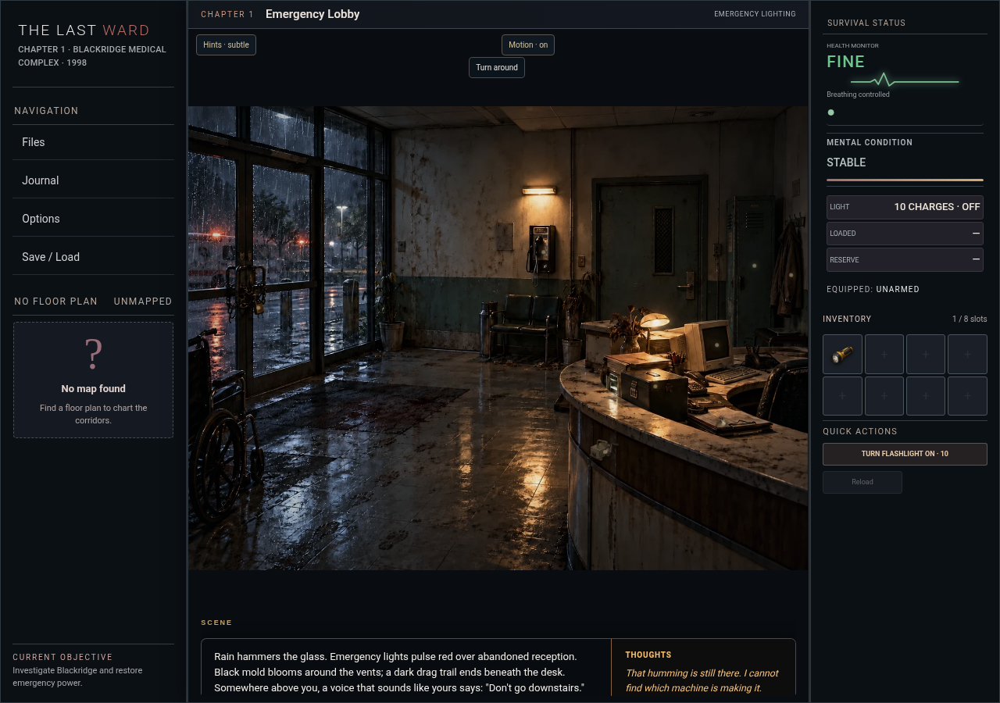

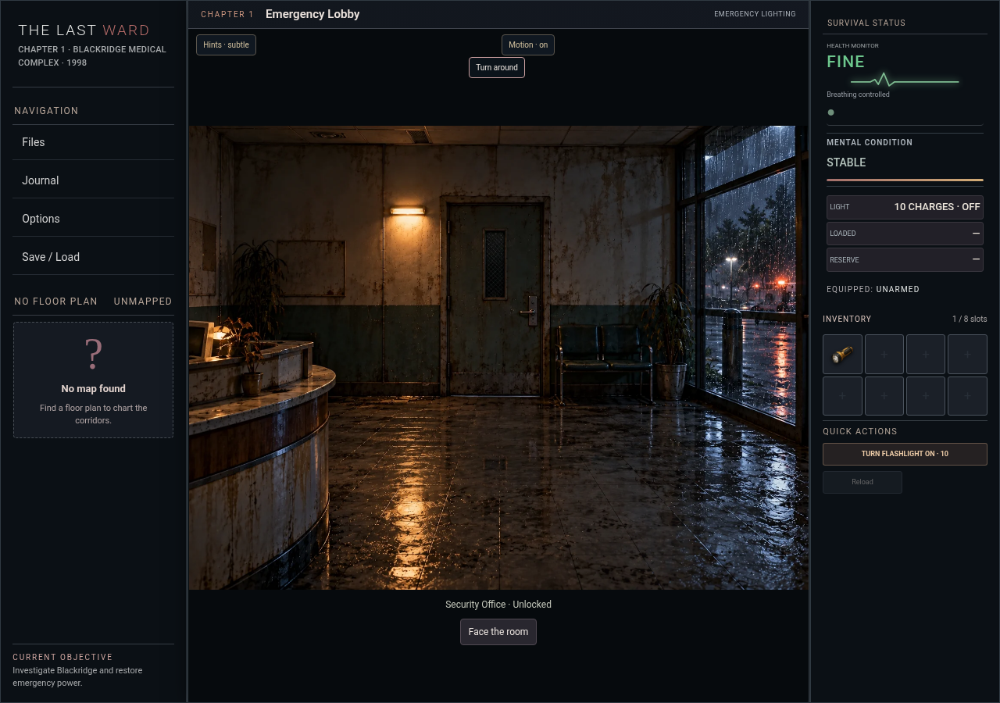

## Captures

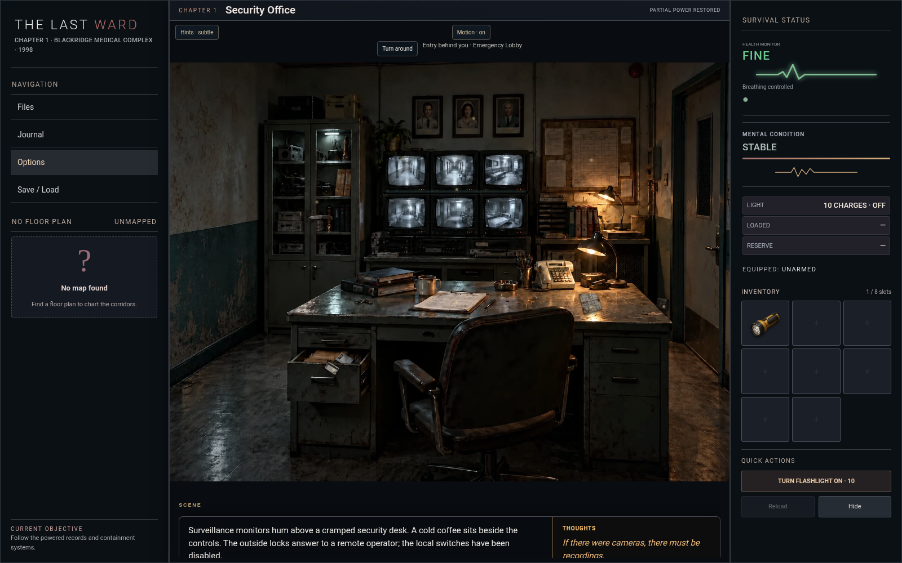

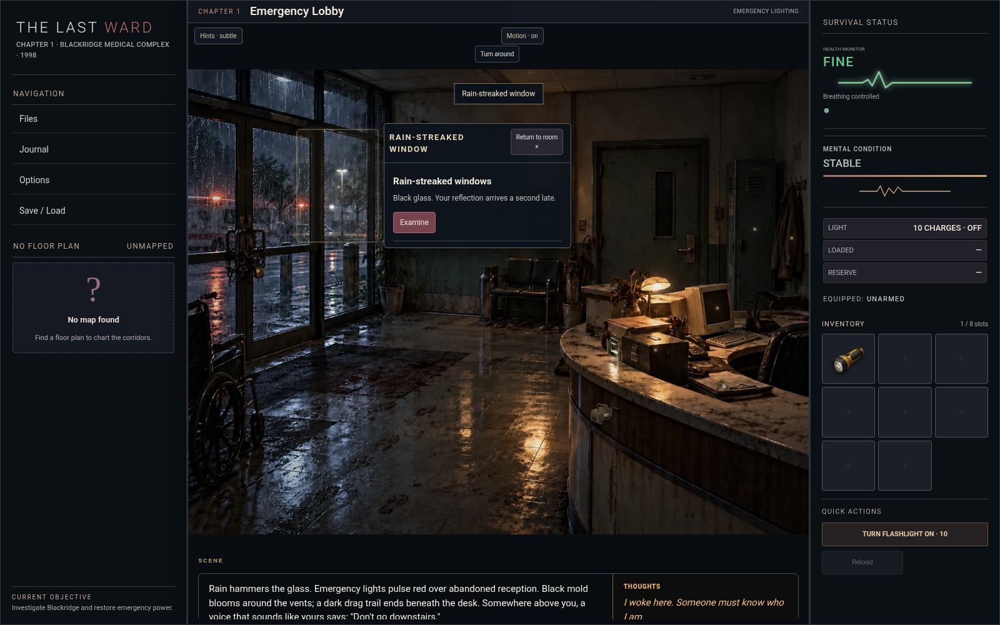

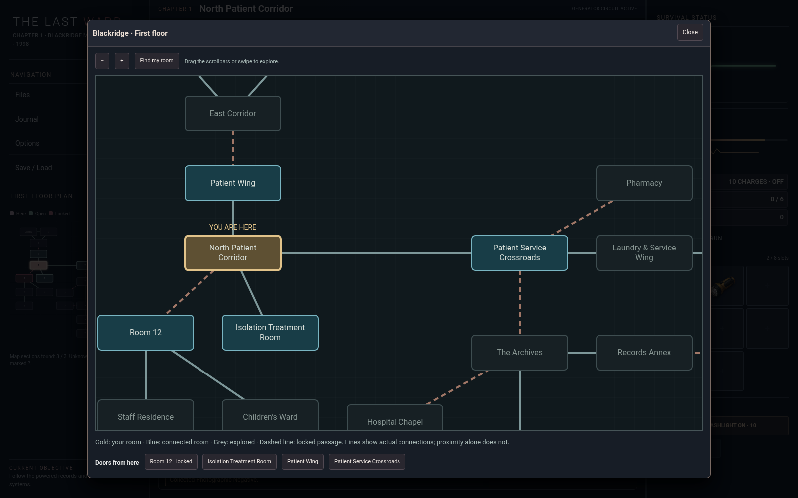

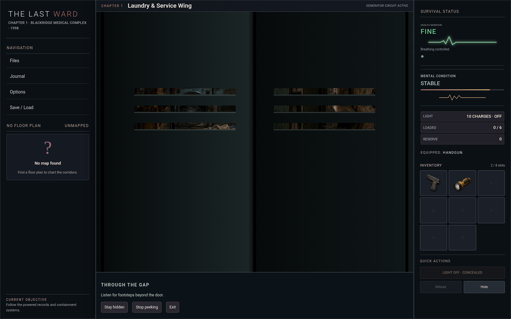

## Pickup example

The handgun is separate from the open case; collecting the handgun leaves an empty case.

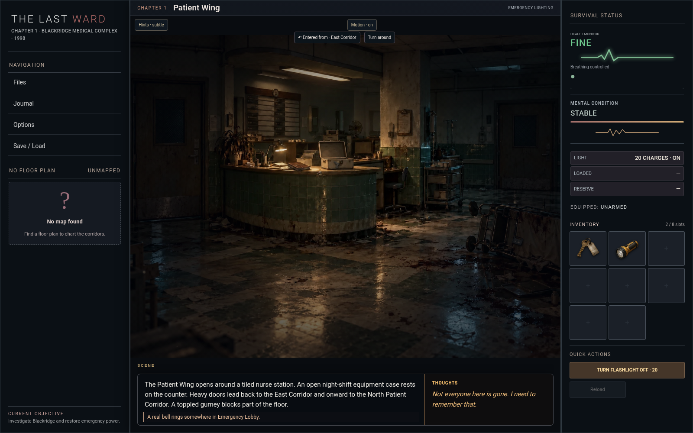

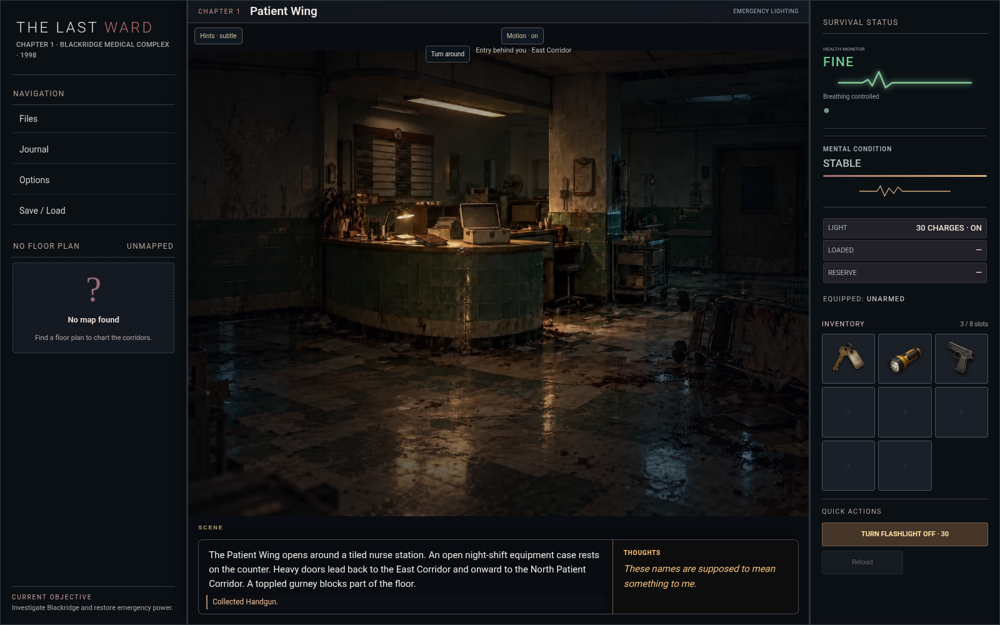

## Refinement review

Inspect and close an object repeatedly: the art should stay at the same scale.
Turn the flashlight on in a lit room: ambient light should remain intact.
Unresolved objects show small, quiet markers without mouse sweeping.

In Laundry, confirm setup to arm the hoist before pursuit, or cancel without
using it. Its hanging load and dropped-load aftermath persist. Releasing it
manually warns that it is one-use even with nobody underneath.

Struggle creates an injured escape opening; returning exposes the same surviving
infected. Collect the utility knife from Security for knife attacks or Daniel’s
confirmed choice. Daniel is covered afterward; a rejected/cancelled choice changes nothing.

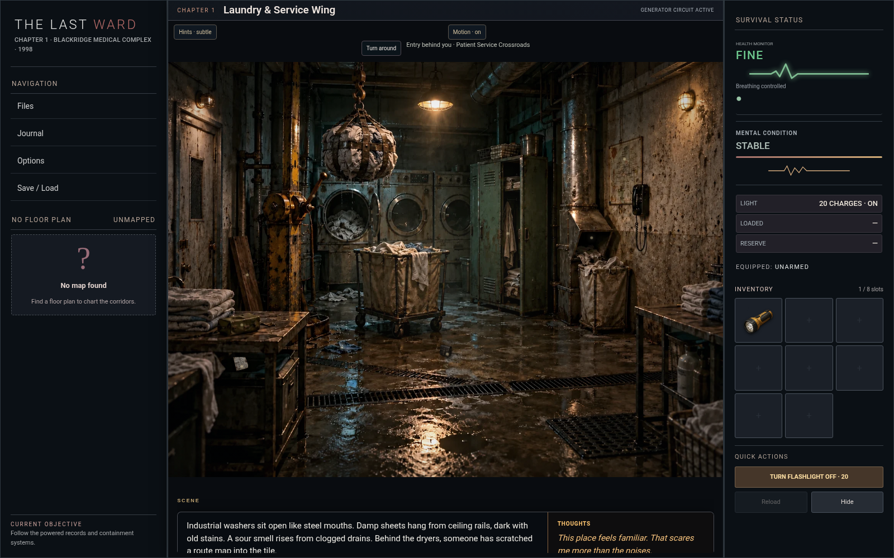

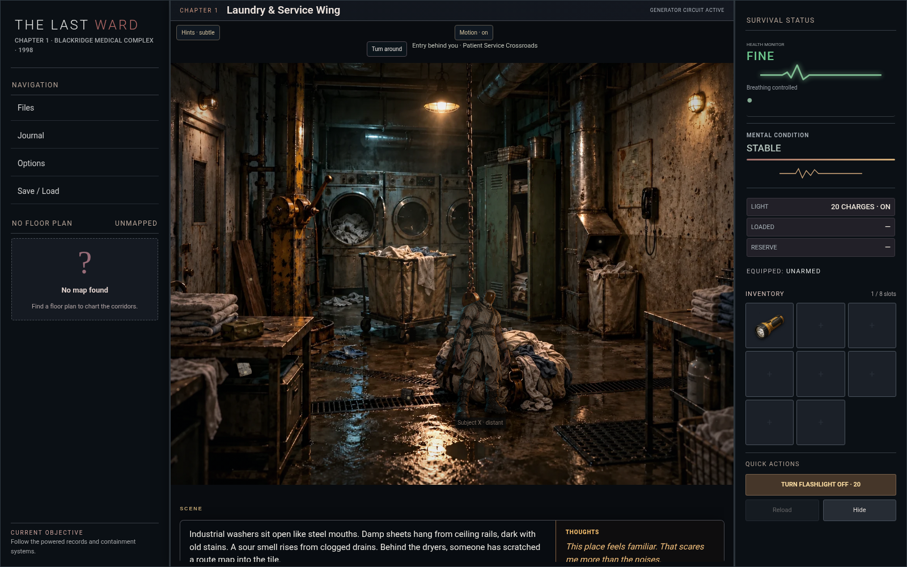

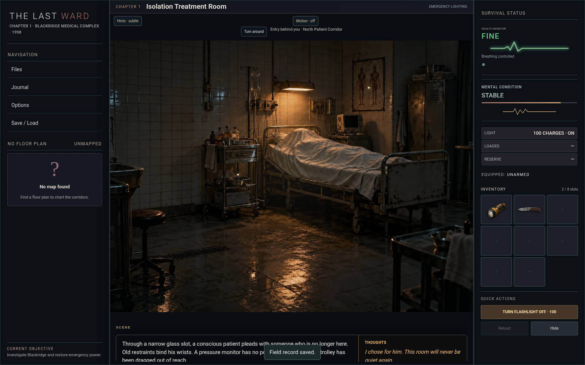
